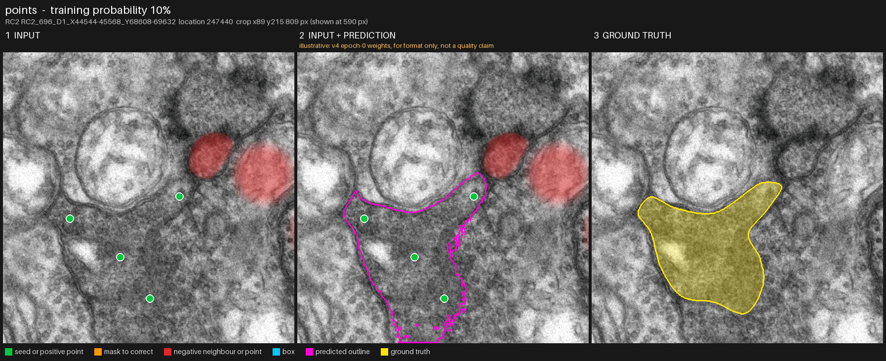
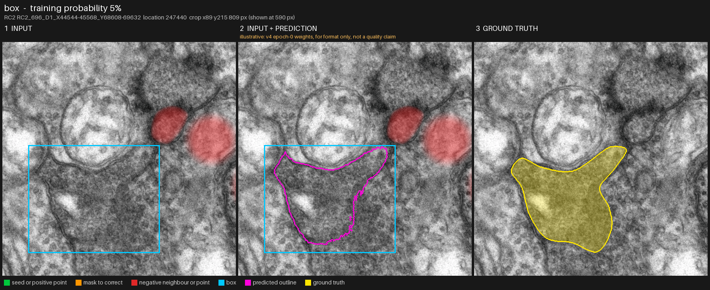
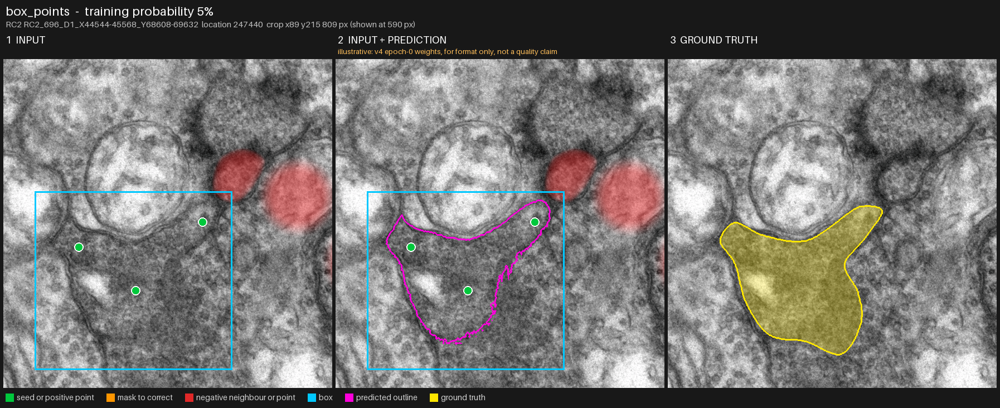
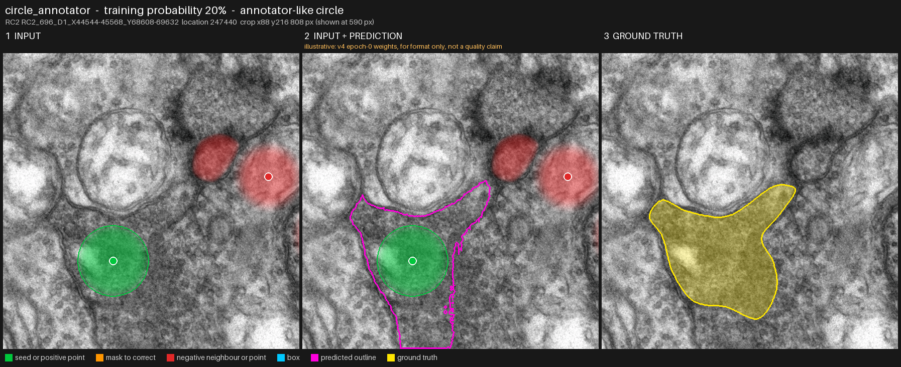
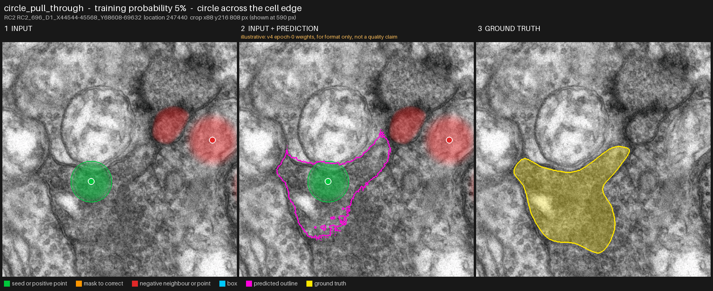
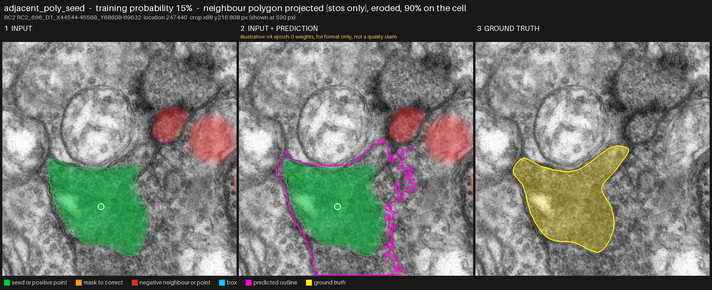
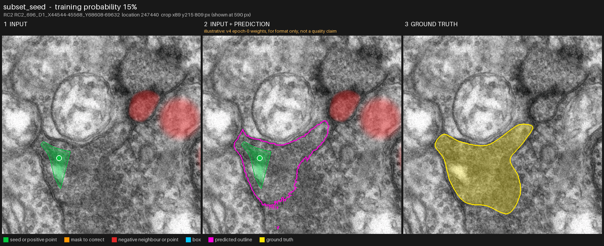
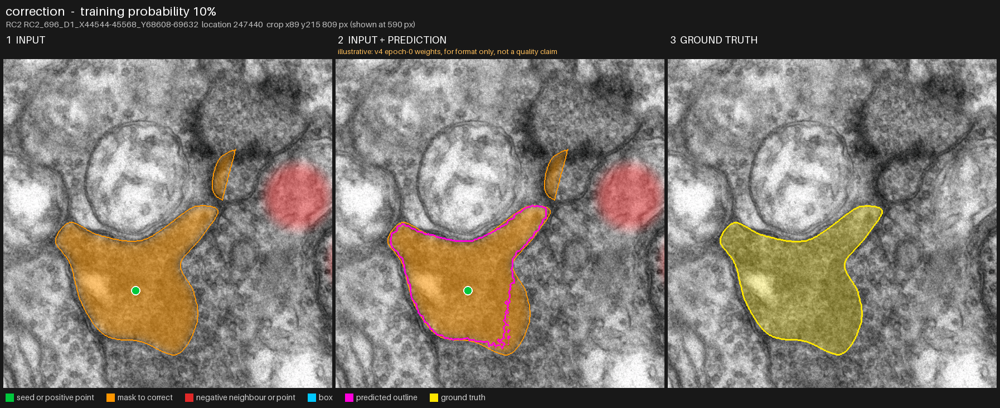
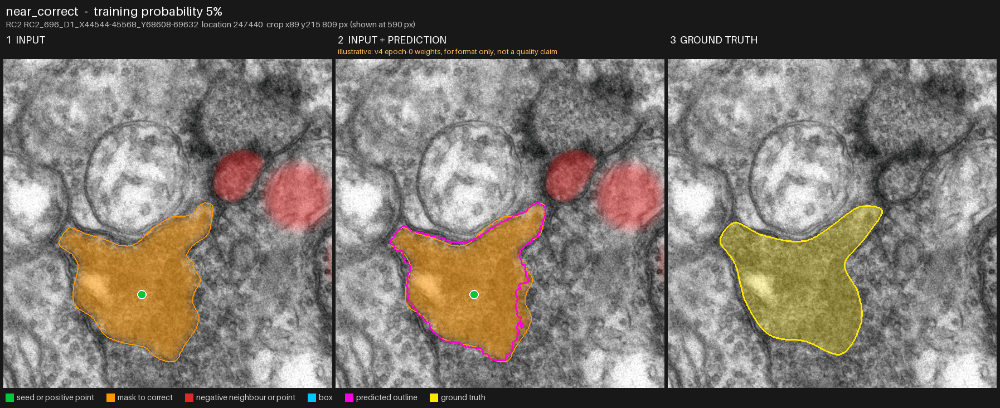

# Prompt families at a glance

One image per prompt family the trainer draws, on one real crop (RC2, location 247440, section z=696; every image
uses the same crop and the same sample). Each image has three panels: the input with its prompt drawn on it, the
same with the outline of the model's predicted mask, and the ground truth. The prompts are built by the trainer's
own code (`EMSegDataset` with `build_prompt`), so the images show what the model is given.

Reading the images: green is a seed or a foreground point, orange a mask to correct, red the negative neighbours
(fill opacity follows the prompt's logit, so the tapering edge is visible) and background points, cyan a box,
magenta the predicted outline and yellow the ground truth. Each family's training probability is the `prompt.prob_*`
value in `sam2_segmentation_trainer/config/em_finetune.yaml`. Every one of a sample's four variants is drawn from that
mix without replacement (no family is forced), so a family's realised share of the variants differs from its
probability (README, "Prompts in training").

The prediction panels are illustrative: v4 epoch-0 weights (`/storage4/Sam2Trainer/runs/sam2_em_v4_centred/best_model.pt`,
the run was aborted after epoch 0), for format only, not a quality claim.

To regenerate every image (inside the trainer container, from `/workspace`; about one minute on the shared GPU):

```
python scripts/make_prompt_overview.py --out docs/img/prompts --volume RC2
```

Use `--no-predict` to draw only the input and ground-truth panels, `--families points,box` for a subset and
`--sample IMAGEKEY:LOCATION_ID` for another crop. To add a family, add one `Family` entry to `FAMILIES` in the script.

## Points (`points`)



Simulates a user clicking one to nine foreground points inside the cell (count drawn with a Benford law), kept at least 15 px from the edge. Negative neighbours ride along as a red area and, by chance, background points. Training probability: 10%.

Regenerate: `python scripts/make_prompt_overview.py --families points`

## Box (`box`)



Simulates a loose box around the cell, each edge pushed out by up to 15% of its length. The box only says the object is probably inside; no loss forces the prediction into it. Training probability: 5%.

Regenerate: `python scripts/make_prompt_overview.py --families box`

## Box plus points (`box_points`)



Simulates a loose box together with one to three foreground points. Training probability: 5%.

Regenerate: `python scripts/make_prompt_overview.py --families box_points`

## Circle seed (`circle_seed`)


Simulates a clean circle seed: the tile's circle or, as here, the inscribed circle times 0.95, with its centre point, that the model must grow to the cell edge. One of three peer circle prompts (with circle_annotator and circle_pull_through below); an annotator or pull-through circle that cannot be drawn falls back to this one. Training probability: 10%.

Regenerate: `python scripts/make_prompt_overview.py --families circle_seed`

## Circle annotator (`circle_annotator`)



Simulates an annotator-drawn circle: a centre at a random depth and a random radius, smaller than the inscribed circle and often off-centre (docs/circle_annotator_spec.md). It is a prompt type of the training mix and also a validation family (it picks the best checkpoint). Training probability: 20%.

Regenerate: `python scripts/make_prompt_overview.py --families circle_annotator`

## Circle pull-through (`circle_pull_through`)



Simulates an annotator circle drawn across the cell edge: at least 60% of the disc lies inside the cell and at least 5% outside (here 82.5% inside, the cap past the upper edge is outside). The model must ignore the part outside and expand to the full cell. The prompt is not clipped; the part outside the cell gets no containment weight. Training probability: 5%. No validation family yet.

Regenerate: `python scripts/make_prompt_overview.py --families circle_pull_through`

## Adjacent polygon seed (`adjacent_poly_seed`)



Simulates the Viking workflow of carrying the linked polygon forward from the neighbouring section. The dataset draws it from the exporter's `<VOL>/shapes.jsonl`: `build_tile_context` loads each volume's file and, with `data.registration_root` and `data.corrections_root`, carries every linked outline through the volume's stos group (and the published residual correction where it lowers the links' carry error; not on RC2) into the target section's mosaic (`data/projection.py`). `TileContext.adjacent_draw` picks one outline from a section 1 to 2 away (from `[seed, epoch, index, 0, 4]` when there are several), erodes it by 0-10 px and keeps it only when at least 60% of its area in the tile lies on the cell; `build_prompt` uses it where it lands (the image title gives the placement and the share on the cell). A failing outline is not a prompt: the variant is drawn again. Without the registration data the outline is placed on the target's centroid and `fit_adjacent_poly_seed` scales it inside the cell, and the title says so. Training probability: 15%, on the samples that have a linked outline (RC2 almost all, RC1 3, RPC1 622 and RPC2 581 locations); elsewhere its share moves to the three circle prompts in proportion.

The exporter's coordinates are each section's own mosaic pixels, not registered volume pixels (a linked neighbour lies a median 23,000 px from its target in RC2), which is why the projection is needed; through the stos a neighbour's centroid lands a median 49-58 px from its target's. This image was drawn with the production path when its title says "projected" (the trainer container has `/storage4`; without a `/corrections` mount RPC1 and RPC2 are projected through the stos only).

Regenerate: `python scripts/make_prompt_overview.py --families adjacent_poly_seed`

## Subset seed (`subset_seed`)



Simulates a partial trace: the true mask eroded by 10 to 40 px, then optionally cut straight or along the cell, with one point inside it. The model must grow it to the full cell. Training probability: 15%.

Regenerate: `python scripts/make_prompt_overview.py --families subset_seed`

## Mask to correct (`correction`)



Simulates a wrong mask from an earlier step: the true mask grown, eroded, scaled, warped, simplified or merged with a neighbour (the small orange blob here is a merged neighbour). It is a suggestion, fed at a lower logit than a seed, and the click comes from the mask the user sees. Training probability: 10%.

Regenerate: `python scripts/make_prompt_overview.py --families correction`

## Near-correct mask (`near_correct`)



Simulates a good human trace, 5 to 12 px of outline wobble plus one to three local bulges or dents. The model must leave it at least as good (the validation 'do no harm' check). Training probability: 5%.

Regenerate: `python scripts/make_prompt_overview.py --families near_correct`

## Not yet drawn

- Carried-forward circle family (planned). A circle copied from another section is far off-centre in real data; it
  gets its own family if it reaches the model unadjusted in production (docs/circle_annotator_spec.md, 'Not in this
  change').
- Polygon carry-forward family (planned).
- A `circle_pull_through` validation family (possible follow-up; today it is a training prompt only).
